# 🥟 Baozi Store – API REST

API REST simples para controle de **clientes, produtos e pedidos** da *Baozi Store* (loja de pão chinês).
Trabalho da disciplina **Desenvolvimento Web Back-End** (UNINTER).

**Tecnologias:** Java 17 · Spring Boot 3 · Spring Data JPA · Bean Validation · H2 / MySQL · Postman

## Como executar

Requisitos: JDK 17+ e Maven (ou a IDE com Maven integrado: IntelliJ, Eclipse STS, VS Code).

```bash
mvn spring-boot:run
```

A API sobe em `http://localhost:8080`.

### Banco de dados

| Perfil | Banco | Como usar |
|--------|-------|-----------|
| padrão | **H2** em arquivo (`./data/baozidb`) – não precisa instalar nada | `mvn spring-boot:run` |
| `mysql` | **MySQL / MariaDB** (`localhost:3306`, banco `baozi_store`, usuário/senha `root`/`root`) | `mvn spring-boot:run -Dspring-boot.run.profiles=mysql` |

* Console do H2: `http://localhost:8080/h2-console` (JDBC URL `jdbc:h2:file:./data/baozidb`, user `sa`, senha vazia).
* Para MySQL, ajuste usuário/senha em `src/main/resources/application-mysql.properties`.
* As tabelas (`cliente`, `produto`, `pedido`) são criadas automaticamente pelo Hibernate.

## Estrutura (padrão MVC do Spring)

```
src/main/java/br/com/baozistore
├── BaoziStoreApplication.java
├── model/        Cliente, Produto, Pedido (entidades JPA)
├── repository/   ClienteRepository, ProdutoRepository, PedidoRepository
├── controller/   ClienteController, ProdutoController, PedidoController, ApiExceptionHandler
└── dto/          PedidoRequest
```

## Entidades

| Cliente | Produto | Pedido |
|---|---|---|
| id (Long) | id (Long) | id (Long) |
| nome (String) | nome (String) | clienteId (Long, FK → cliente) |
| clienteDesde (LocalDate) | preco (BigDecimal) | produtoId (Long, FK → produto) |
| | estoque (Boolean) | quantidade (Integer) |

## Endpoints

Para cada recurso (`/clientes`, `/produtos`, `/pedidos`):

| Método | URL | Descrição | Resposta |
|---|---|---|---|
| POST | `/{recurso}` | Criar | 201 |
| GET | `/{recurso}/{id}` | Consultar por ID | 200 / 404 |
| GET | `/{recurso}` | Listar todos | 200 |
| DELETE | `/{recurso}/{id}` | Apagar | 204 / 404 / 409* |
| PUT | `/{recurso}/{id}` | Atualizar (opcional) | 200 / 404 |

\* 409 ao apagar cliente/produto que já possui pedidos.

### Exemplos

```bash
curl -X POST localhost:8080/clientes -H "Content-Type: application/json" \
     -d '{"nome":"SeuNome1234567","clienteDesde":"2026-09-30"}'

curl -X POST localhost:8080/produtos -H "Content-Type: application/json" \
     -d '{"nome":"Baozi Tradicional","preco":8.50,"estoque":true}'

curl -X POST localhost:8080/pedidos -H "Content-Type: application/json" \
     -d '{"clienteId":1,"produtoId":1,"quantidade":6}'

curl localhost:8080/pedidos
```

## Testes no Postman

Importe `entrega/Baozi_Store_Postman_Collection.json` (e, opcionalmente, `entrega/Baozi_Store_Local.postman_environment.json`).

| Pasta | Conteúdo |
|---|---|
| 1 - Criar (POST) | cliente, produto e pedido da situação fictícia |
| 2 - Listar todos (GET) | listagem de clientes, produtos e pedidos |
| 3 - Consultar por ID | GET /{id} das três entidades |
| 4 - Apagar (DELETE) | apaga o pedido e confirma com 404 |
| 5 - Extras: PUT e integridade | atualização e bloqueio de exclusão (409) |
| 6 - Extras: validações e erros | 400, 404 e 422 |

As requisições têm testes automáticos (status, JSON e valores) e os POST guardam os IDs em variáveis da coleção.
Para rodar tudo de uma vez: botão **Run** da coleção.

## Gerar o PDF da entrega

```bash
cd entrega
pip install reportlab matplotlib
python gerar_entrega.py --nome "SeuNome" --ru 1234567 --repo "https://github.com/seu-usuario/baozi-store"
```

Salve os prints do Postman em `entrega/prints/` (nomes sugeridos no início do script) e rode de novo para incluí-los no PDF.

## Documento da entrega

O PDF completo (situação fictícia, diagrama de caso de uso, especificação da API e prints) está em
[`entrega/Trabalho_Baozi_Store.pdf`](entrega/Trabalho_Baozi_Store.pdf).

Autor: **Vinícius Barbosa Silva** – RU 5474751

## Diagrama de caso de uso

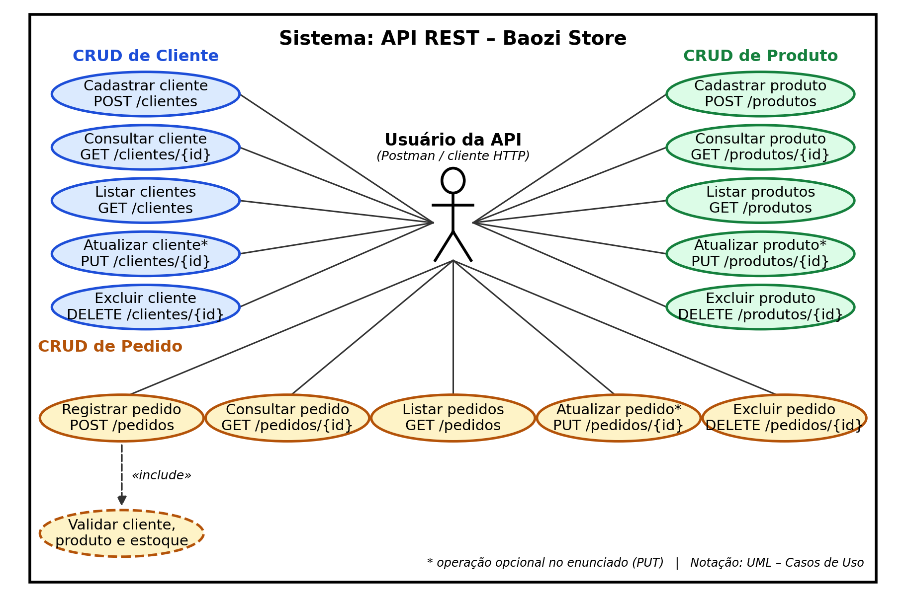

## Prints do Postman

Todos os prints estão na pasta [`entrega/prints`](entrega/prints).

| Teste | Print |
|---|---|
| POST Cliente | 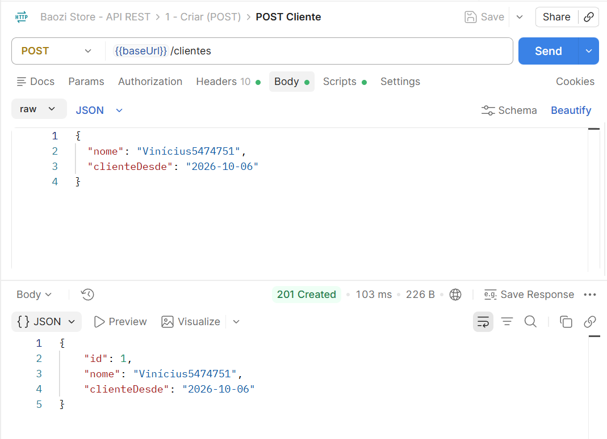 |
| POST Produto | 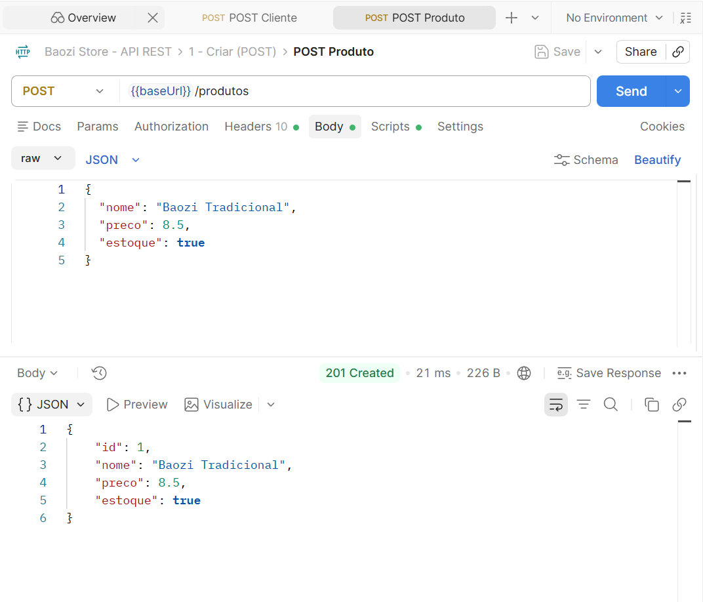 |
| POST Pedido | 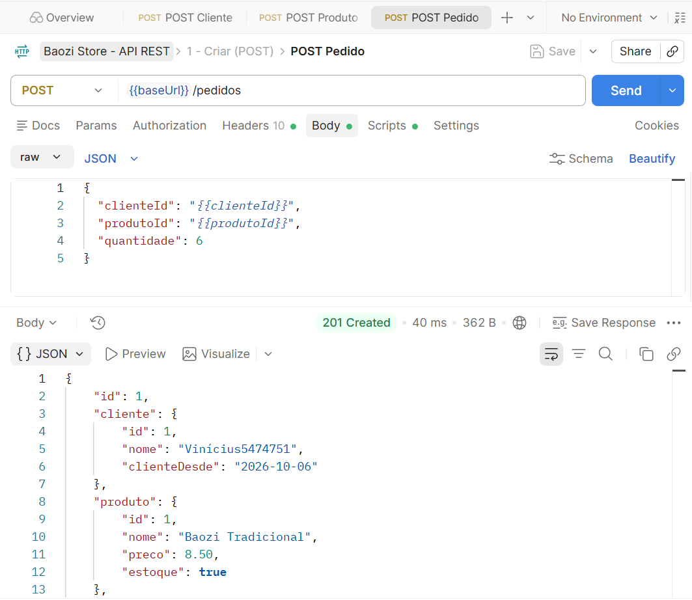 |
| GET Clientes | 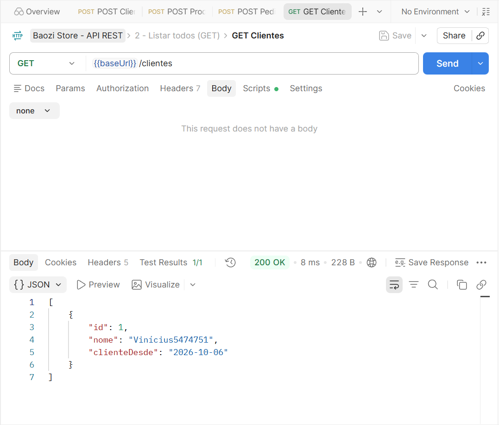 |
| GET Produtos | 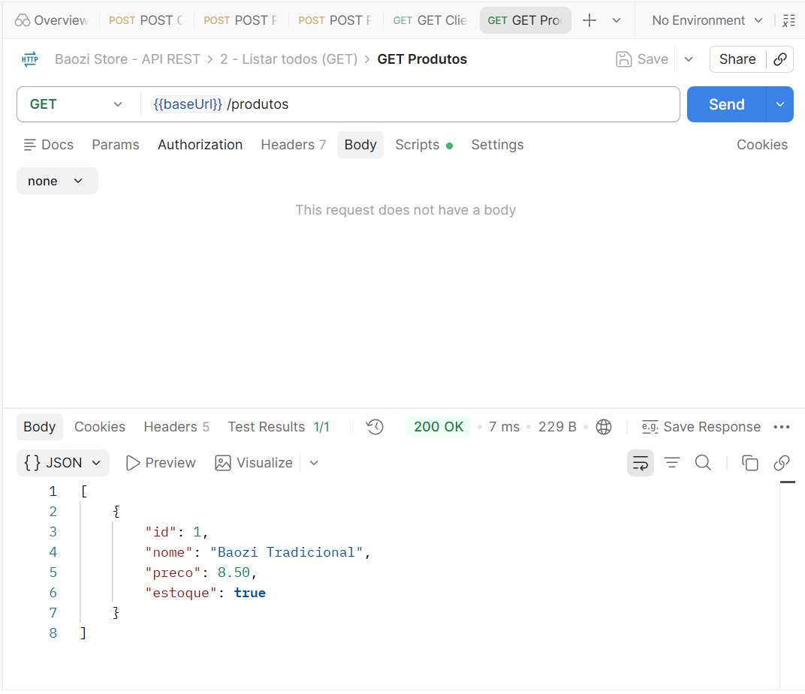 |
| GET Pedidos | 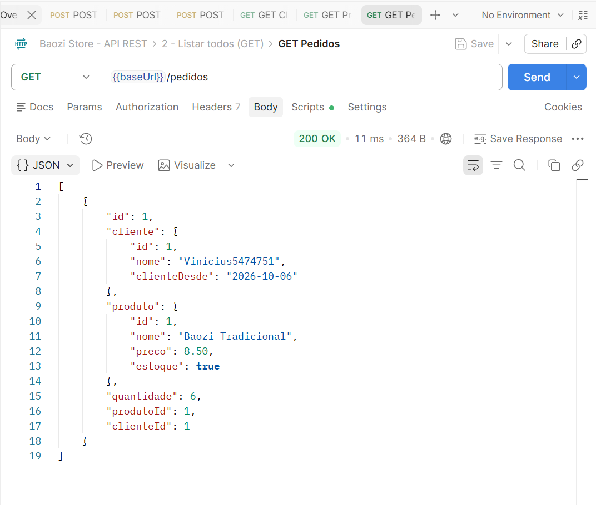 |
| GET Cliente por ID | 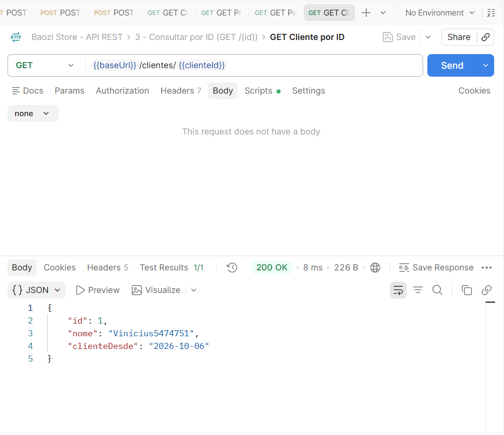 |
| GET Produto por ID | 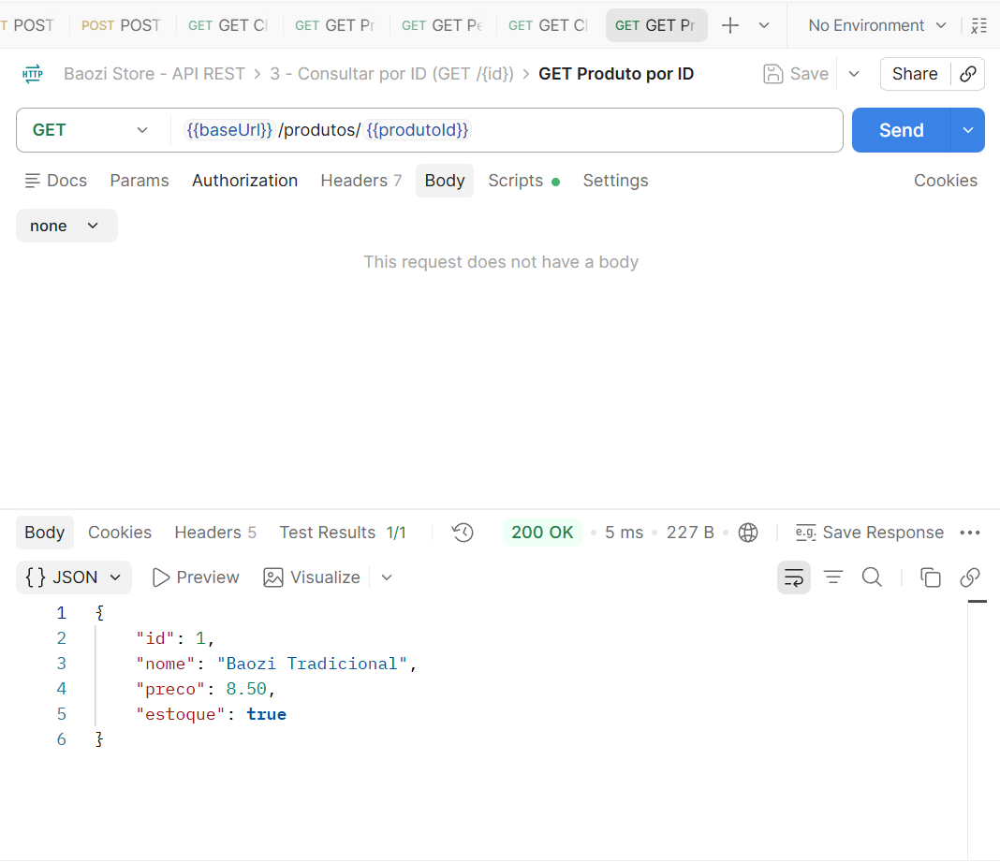 |
| GET Pedido por ID | 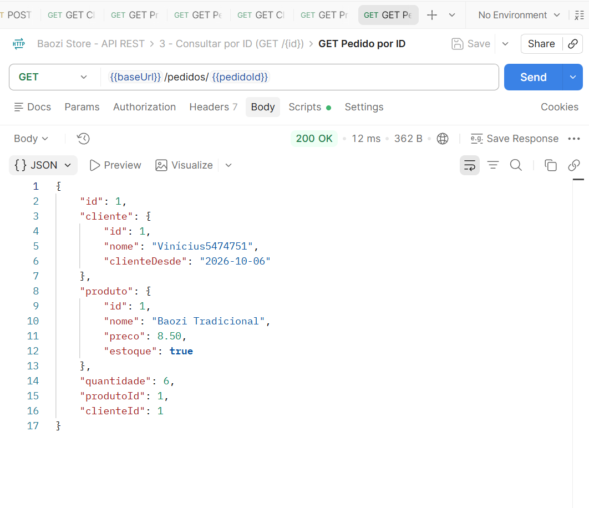 |
| DELETE Pedido | 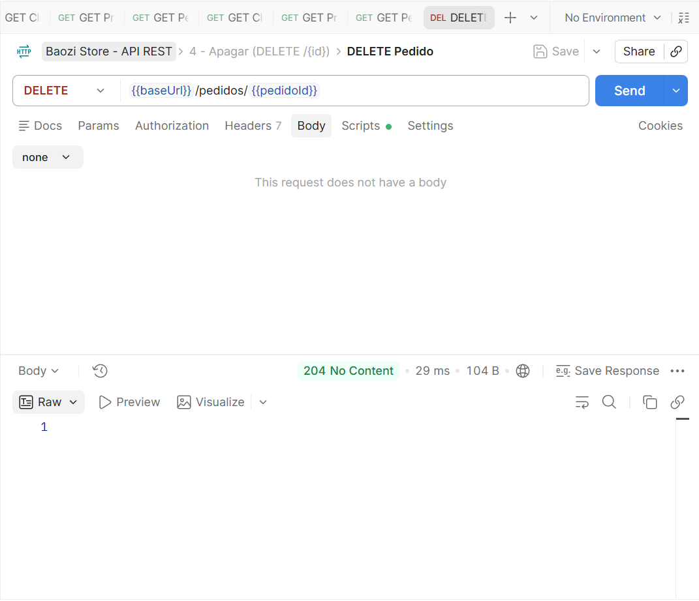 |
| GET Pedido após DELETE (404) | 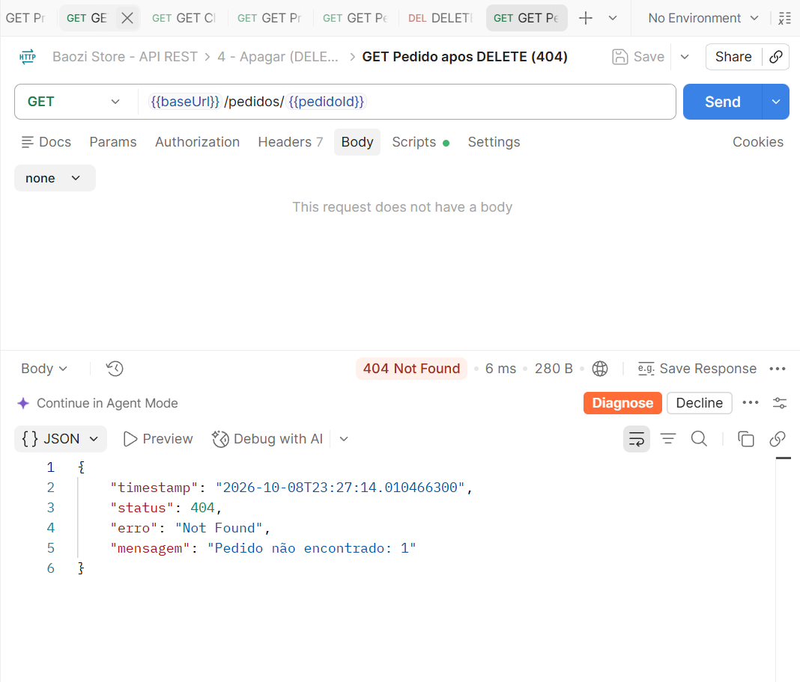 |
